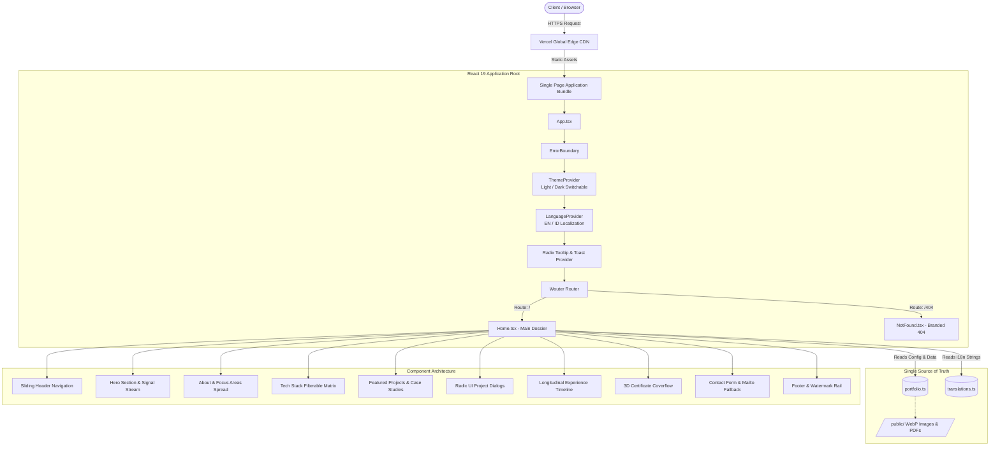

# Fauzi Noorsyabani — Signal Ledger Portfolio & AI Engineering Dossier

<div align="center">

[](https://github.com/fauzinoorsyabani/fauzi-noorsyabani-portfolio-web)
[](https://react.dev/)
[](https://www.typescriptlang.org/)
[](https://vite.dev/)
[](https://tailwindcss.com/)
[](LICENSE)

<br />

**A high-performance, editorial single-page portfolio and applied AI engineering dossier.**  
Engineered with an evidence-first philosophy, bilingual internationalization, persistent dual-theme architecture, and bespoke technical interactions.

[**Explore Live Experience**](https://github.com/fauzinoorsyabani/fauzi-noorsyabani-portfolio-web) · [**Report Issue**](https://github.com/fauzinoorsyabani/fauzi-noorsyabani-portfolio-web/issues) · [**Connect on LinkedIn**](https://linkedin.com/in/fauzinoorsyabani)

</div>

---

## 📑 Table of Contents

- [Executive Summary](#-executive-summary)
- [Key Features & Capabilities](#-key-features--capabilities)
- [Architecture & System Design](#-architecture--system-design)
- [Design System: Signal Ledger](#-design-system-signal-ledger)
  - [Color Palette Tokens](#color-palette-tokens)
  - [Typographic Hierarchy](#typographic-hierarchy)
  - [Motion & Micro-Interaction Philosophy](#motion--micro-interaction-philosophy)
- [Engineering Toolkit & Tech Stack](#-engineering-toolkit--tech-stack)
- [Featured Engineering Projects](#-featured-engineering-projects)
- [Repository Structure](#-repository-structure)
- [Single Source of Truth Configuration](#-single-source-of-truth-configuration)
- [Getting Started & Local Development](#-getting-started--local-development)
  - [Prerequisites](#prerequisites)
  - [Installation](#installation)
  - [Development Server](#development-server)
  - [Type Checking & Production Build](#type-checking--production-build)
- [Deployment & CI/CD Pipeline](#-deployment--cicd-pipeline)
- [Performance, Accessibility & SEO](#-performance-accessibility--seo)
- [Professional Profile & Contact](#-professional-profile--contact)
- [License & Acknowledgments](#-license--acknowledgments)

---

## 💡 Executive Summary

This repository houses the source code for the personal portfolio of **Fauzi Noorsyabani**, a **Full Stack AI Engineer** and Information Systems graduate from Universitas Siliwangi (*GPA 3.89 / 4.00, Cum Laude*).

Rather than defaulting to cookie-cutter developer landing page templates with generic glass cards, this application implements the bespoke **Signal Ledger** design system: an editorial visual experience influenced by academic research journals, system dossiers, and high-end institutional reports.

### Professional Snapshot
- **Core Specialization:** Applied AI, LLM Orchestration & RAG Pipelines, Enterprise Data Warehousing, Full-Stack Web Architecture.
- **Leadership & Community:** Google Student Ambassador Campus Lead (selected from 12,000+ national applicants), Capstone Lead for 900+ hour AI product initiative with Pijak × IBM SkillsBuild.
- **Accolades:** 1st Place at Dicoding Developer Conference (AI for Cloud Infra & DevOps), 1st Place MyBDDInsight Challenge (Dicoding & Kemenparekraf), 3x National Science Olympiad Gold Medalist (Mathematics & Accounting), BNSP Certified ICT Project Manager.

---

## 🌟 Key Features & Capabilities

| Capability | Engineering Implementation | Benefit |
| :--- | :--- | :--- |
| **🌐 Full Bilingual i18n** | Custom React `LanguageContext` with `localStorage` memory and dictionary tree in `translations.ts` | Seamless one-click toggling between **English** and **Bahasa Indonesia** across all UI elements, headings, case study summaries, and timelines without layout reflow. |
| **🌓 Adaptive Dual Themes** | `ThemeContext` utilizing DOM root class toggling (`dark`) + local storage persistence | Flawless readability in both a warm editorial cream paper theme (`#FAF9F5`) and deep midnight navy dark mode (`#0B1735`), compliant with WCAG AAA contrast ratios. |
| **🧭 Sliding Active Nav Pill** | Real-time viewport scroll-spy coupled with hardware-accelerated CSS `transform` interpolation | Tactile, fluid navigation tracking the reader's vertical reading progress across 6 thematic page sections. |
| **🔍 Interactive Project Modals** | Accessible Radix UI Dialog primitives (`client/src/components/ui/dialog.tsx`) | Allows deep technical inspection of projects (architecture details, metric outcomes, stack badges, and live demo / source links) with focus traps and keyboard dismissal (`ESC`). |
| **🏆 3D Certificate Coverflow** | Bespoke carousel engine (`CertificateCoverflow.tsx`) with dynamic perspective, drag physics, and modal zoom | Interactive presentation of verified diplomas, BNSP ICT Project Management certification, and national competition awards. |
| **🎨 Bespoke Tech Stack Matrix** | Custom SVG icon component (`TechIcon.tsx`, 100KB+ inline vectors) with 8 categorization tabs | Filterable catalog covering 50+ tools, languages, and frameworks with theme-aware hover contrast and brand accents. |
| **⚡ Watermark Typography** | Gede Arya-inspired giant display text with responsive viewport units (`vw`) | Sophisticated editorial branding anchored in the background canvas that does not obstruct interactive elements. |
| **♿ Strict Accessibility** | Native skip-links, ARIA landmarks, semantic HTML5, visible focus indicators, and `prefers-reduced-motion` | Usable across all modern assistive devices, keyboard-only operators, and low-bandwidth connections. |

---

## 🏗️ Architecture & System Design

The application is structured as a zero-latency client-side Single Page Application (SPA) powered by **React 19**, **Vite 7**, and **Tailwind CSS 4**, bundled for high-efficiency edge delivery on **Vercel**.



---

## 🎨 Design System: Signal Ledger

The visual identity is grounded in **editorial minimalism** and technical precision. Instead of generic modern tech clichés (such as hyper-saturated purples and heavy neon borders), Signal Ledger draws from physical print mediums: archival paper, deep bookmaking inks, and a single decisive cobalt data signal.

### Color Palette Tokens

| Token Name | Light Mode Value | Dark Mode Value | Semantic Role |
| :--- | :--- | :--- | :--- |
| **Canvas / Paper** | `#FAF9F5` (Warm Alabaster) | `#0B1735` (Midnight Navy) | Primary viewport background and calm reading surface |
| **Primary Ink** | `#0D1117` (Deep Obsidian) | `#F8FAFC` (Pure Signal White) | Editorial headlines, bold numerals, and core body text |
| **Cobalt Signal** | `#246BFD` (Electric Cobalt) | `#3B82F6` (Vibrant Blue) | Primary CTAs, active navigation state, active data nodes, focus rings |
| **Card / Surface** | `#FFFFFF` (Clean White) | `#111C3D` (Deep Navy Surface) | Elevating project cards, technical dialogs, and code blocks |
| **Data Border** | `#E2E8F0` (Muted Slate) | `#1E293B` (Subtle Navy Border) | Editorial hairline rules, divider borders, and table matrices |
| **Muted Metadata** | `#64748B` (Cool Slate) | `#94A3B8` (Muted Steel) | Section numbers, dates, tags, and secondary documentation |

### Typographic Hierarchy

Three intentional typeface families are orchestrated via Google Fonts with zero layout shift:

1. **Display & Headings — [Space Grotesk](https://fonts.google.com/specimen/Space+Grotesk)**  
   *Weights: 400, 500, 600, 700*  
   Used for section kickers, major impact headlines, project titles, and the giant background watermark. Provides a confident, mechanical yet human posture.
2. **Body & Interface — [Manrope](https://fonts.google.com/specimen/Manrope)**  
   *Weights: 400, 500, 600, 700*  
   Used for narrative paragraphs, biographical spreads, form labels, and interactive button text. Delivers exceptional readability across all screen densities.
3. **Metadata & Code — [IBM Plex Mono](https://fonts.google.com/specimen/IBM+Plex+Mono)**  
   *Weights: 400, 500, 600*  
   Used for timestamps, index codes (`01 / ARCHITECTURE`), technical skill tags, KPI numbers, and data signals.

### Motion & Micro-Interaction Philosophy
- **Evidence before ornament:** Animations only serve to establish spatial hierarchy and indicate state changes.
- **Hardware-accelerated properties:** Only `opacity` and `transform` are animated to ensure continuous 60fps / 120fps rendering without layout recalculations.
- **Respect for accessibility:** All continuous background movement (`SignalStream`, `SignalOrbit`) and staggered entry transitions are automatically disabled when `prefers-reduced-motion: reduce` is active.

---

## 🛠️ Engineering Toolkit & Tech Stack

The portfolio features a custom matrix covering 8 primary technical domains, rendered with theme-adaptive SVG vectors in [`TechIcon.tsx`](client/src/components/TechIcon.tsx):

```text
┌────────────────────────────────────────────────────────────────────────┐
│                      ENGINEERING ECOSYSTEM DOMAINS                     │
├───────────────────┬────────────────────────────────────────────────────┤
│ 01. Languages     │ Python · TypeScript · JavaScript · PHP · Go · SQL  │
│                   │ Java · C · C++ · C# · Dart                         │
├───────────────────┼────────────────────────────────────────────────────┤
│ 02. Frontend      │ React 19 · Next.js · Vue.js · Tailwind CSS 4       │
│                   │ Radix UI · Framer Motion · HTML5 / CSS3 · Flutter  │
├───────────────────┼────────────────────────────────────────────────────┤
│ 03. Backend & API │ FastAPI · Laravel · Node.js · Express · Flask      │
│                   │ RESTful Architectures · Supabase                   │
├───────────────────┼────────────────────────────────────────────────────┤
│ 04. AI & ML       │ PyTorch · TensorFlow · Scikit-learn · Pandas       │
│                   │ NumPy · LangChain · LangGraph · Streamlit · OpenCV │
├───────────────────┼────────────────────────────────────────────────────┤
│ 05. AI Tooling    │ Claude · Gemini · ChatGPT · Antigravity IDE       │
│                   │ Cursor · GitHub Copilot · ChromaDB · Google Colab  │
├───────────────────┼────────────────────────────────────────────────────┤
│ 06. Databases     │ PostgreSQL · MySQL · SQLite · MongoDB · Redis      │
│                   │ Supabase · Firebase · ChromaDB (Vector Store)      │
├───────────────────┼────────────────────────────────────────────────────┤
│ 07. DevOps & Cloud│ AWS (EC2, S3) · Google Cloud Platform · Docker     │
│                   │ Kubernetes · GitHub Actions CI/CD · Nginx · Vercel │
├───────────────────┼────────────────────────────────────────────────────┤
│ 08. Dev Tools     │ Git · GitHub · GitLab · VS Code · Postman · Figma  │
│                   │ Jira · Atlassian Suite · Slack                     │
└───────────────────┴────────────────────────────────────────────────────┘
```

---

## 🚀 Featured Engineering Projects

The portfolio showcases real, production-tested software, data systems, and applied research:

### 1. Forensic Air Quality Analytics & Multi-Objective ML Pipeline
- **Domain:** Applied Machine Learning · Environmental Intelligence
- **Context:** Industrial & Urban Air Quality Sensor Telemetry
- **Tech Stack:** Python, XGBoost, Random Forest, Scikit-learn, Pandas, NumPy, Matplotlib, Seaborn
- **Impact:** Built an end-to-end multi-objective ML pipeline evaluating urban atmospheric pollutants across 500 monitoring observations. Engineered physical non-negative clipping for sensor zero-drift, atmospheric domain features (Combustion Index, Nitrogen Oxidation Ratio), and an anti-leakage dual-branch architecture. Achieved $R^2 = 0.6670$ with zero-mean normal residuals for $PM_{2.5}$ forecasting and 0.6048 Macro F1 (+30.4% vs baseline) with 0.74 recall for high-risk warning classification.

### 2. IDX Market Intelligence — Automated Star-Schema Warehouse & Pipeline
- **Domain:** Enterprise Data Engineering · Financial Intelligence
- **Context:** Indonesia Stock Exchange (IDX30 Benchmark Analytics)
- **Tech Stack:** Python, PostgreSQL, Kimball Star Schema, Streamlit, Plotly, GitHub Actions CI/CD, Power BI
- **Impact:** Automated ELT pipeline processing 27,150+ historical records across 30 IDX equities, IHSG benchmark, and USD/IDR rates. Implemented 100% idempotent upserts (`INSERT ... ON CONFLICT DO UPDATE`) ensuring 0% duplicate records, paired with a circuit-breaker Data Quality Gate executing 8 automated deterministic integrity checks (price bounds, FK integrity, and 35% ARA/ARB regulatory limits) synchronized daily at 17:00 WIB via zero-cost GitHub Actions cron jobs.

### 3. Geo Booster (ZiuLabs) — Digital Commerce & AI SaaS Platform
- **Domain:** Product Engineering · Full-Stack & Systems Architecture
- **Context:** Production Commerce & AI SaaS Licensing Ecosystem ([ziulabs.biz.id](https://www.ziulabs.biz.id))
- **Tech Stack:** PHP 8.3+, MySQL 8, Cloudflare Tunnel Reverse Proxy, Modular Monolith, JavaScript, Tailwind CSS
- **Impact:** Architected and deployed an OWASP-compliant modular commerce platform for curated digital products and AI tooling licenses. Features sub-second edge response times, automated catalog and inventory management, WhatsApp automated checkout flows, and self-hosted Cloudflare edge tunneling with zero frontend build overhead.

### 4. Fauzi / Journal — Editorial Web Publishing & Studio Platform
- **Domain:** Product Engineering · Full-Stack Web Architecture
- **Context:** Editorial Publishing Studio ([fauzijournal.web.id](https://fauzijournal.web.id))
- **Tech Stack:** React 19, TypeScript, tRPC, MySQL (TiDB Cloud Serverless), Tailwind CSS, Vercel
- **Impact:** Live production editorial platform featuring automated client-side WebP image optimization, Clerk multi-tier role authorization (Super Admin vs Author), TipTap rich-text canvas, debounced LocalStorage draft recovery, and 100% free serverless architecture.

### 5. Wisata Jelajah Indonesia — Enterprise Travel E-Commerce & Ticketing Platform
- **Domain:** Product Engineering · Full-Stack & Payment Gateway
- **Context:** Tourism & Destination Ticketing Platform ([wisata-jelajah-indonesia.vercel.app](https://wisata-jelajah-indonesia.vercel.app))
- **Tech Stack:** React 18, TypeScript, Tailwind CSS, Express.js, Midtrans Snap, TiDB Cloud, Vercel
- **Impact:** Architected and deployed an enterprise tourism booking platform with multi-channel payment gateway (Midtrans Snap: Virtual Accounts, GoPay, QRIS), print-isolated paperless SVG e-tickets with real-time verification, multi-role authorization (User, Partner/Vendor, Admin), real-time revenue analytics dashboard, and automated serverless deployment.

### 6. Academic Capacity Data Warehouse & Decision Support System (DSS)
- **Domain:** Business Intelligence · Enterprise Data Engineering
- **Context:** Universitas Siliwangi (Institutional Strategic Planning)
- **Tech Stack:** Google Looker Studio, Star Schema, Dimensional Modeling, SQL, Automated ETL
- **Impact:** Centralized academic monitoring across **35 study programs** over 5 longitudinal reporting periods; automated national accreditation compliance tracking and student-to-lecturer ratio indicators.

### 7. PolaStok — AI-Driven Inventory Forecasting Platform
- **Domain:** Applied Generative AI & Machine Learning · Team Leadership
- **Context:** Capstone Project (Pijak × IBM SkillsBuild, 900+ structured engineering hours)
- **Tech Stack:** Python, FastAPI, React, LLM Orchestration, Scikit-learn, Docker
- **Impact:** Led a 5-member engineering team to design, train, and ship an MVP delivering demand prediction, supply chain anomaly detection, and natural language reorder recommendations for Indonesian SMEs.

### 8. Higher Education Tuition & Policy Analytics
- **Domain:** Data Science & Predictive Analytics
- **Context:** PT VINIX Seven Aurum (MSIB Kemendikbudristek)
- **Tech Stack:** Python, Pandas, Power BI, Streamlit, Multivariate Regression
- **Impact:** Analyzed tuition cost structures and enrollment capacity distributions across **97 academic programs** and **11 Indonesian universities**, yielding a **35% improvement** in institutional policy decision accuracy.

### 9. ClinicalNote AI — Automated Medical Scribe & Documentation
- **Domain:** Speech AI & Applied Natural Language Processing
- **Context:** Healthcare Automation Solution
- **Tech Stack:** FastAPI, OpenAI Whisper, GPT-4, LangChain, Docker, AWS EC2
- **Impact:** Designed an intelligent transcription pipeline with sub-two-second latency, implementing custom LangChain chains for automated ICD-10 diagnostic coding, clinical summarization, and prescription extraction.

### 10. HR Analytics Capstone — Large-Scale NLP Pipeline
- **Domain:** Enterprise NLP & Sentiment Intelligence
- **Context:** IBM SkillsBuild × Hacktiv8 Capstone
- **Tech Stack:** IBM Granite Foundation Models, Python, Pandas, Data Pipeline
- **Impact:** Processed and classified **838,566 employee reviews** through an automated LLM extraction pipeline, synthesizing executive recommendations on workforce retention.

---

## 📂 Repository Structure

```text
fauzi-noorsyabani-portfolio-web/
├── .agents/                      # Agentic coding skills, instructions, and workflows
├── client/                       # Frontend application root
│   ├── public/                   # Static public assets (optimized WebP images, certificates, PDFs)
│   │   ├── certificates/         # Verified credential scans and competition diplomas
│   │   ├── fauzi-about-white.webp# High-resolution white background portrait
│   │   ├── fauzi-hero-google.webp# High-resolution Google campus portrait
│   │   ├── logo-thumb.webp       # Favicon and site thumbnail
│   │   └── Fauzi_Noorsyabani_CV.pdf # Professional curriculum vitae
│   ├── src/
│   │   ├── components/           # Reusable UI components
│   │   │   ├── ui/               # Radix UI primitives (Dialog, Tooltip, Sonner Toast)
│   │   │   ├── CertificateCoverflow.tsx # 3D perspective credentials carousel
│   │   │   ├── ErrorBoundary.tsx # Top-level runtime error catcher
│   │   │   ├── TechIcon.tsx      # Comprehensive inline SVG icon dictionary
│   │   │   └── Map.tsx           # Geographical location display
│   │   ├── contexts/             # Global React Context providers
│   │   │   ├── LanguageContext.tsx # EN / ID i18n state and storage handler
│   │   │   └── ThemeContext.tsx    # Light / Dark mode state and DOM handler
│   │   ├── data/                 # Single source of truth data layer
│   │   │   ├── portfolio.ts      # Structured data (projects, skills, certs, links)
│   │   │   └── translations.ts   # Complete bilingual dictionaries (EN & ID)
│   │   ├── pages/                # Page route views
│   │   │   ├── Home.tsx          # Main Signal Ledger single-page application
│   │   │   └── NotFound.tsx      # Branded editorial 404 page
│   │   ├── App.tsx               # Root routing, provider nesting, and toast container
│   │   ├── index.css             # Tailwind CSS 4 directives, custom tokens, and keyframes
│   │   └── main.tsx              # React 19 client entrypoint
│   └── index.html                # HTML document, SEO meta tags, Google Fonts loader
├── patches/                      # Local pnpm dependency patches (e.g. wouter router)
├── server/                       # Node.js production static asset serving runner
├── package.json                  # Project manifest, scripts, and dependencies
├── pnpm-lock.yaml                # Deterministic dependency tree lockfile
├── tsconfig.json                 # TypeScript compiler configuration (strict mode)
├── vercel.json                   # Vercel deployment and SPA client-rewrite rules
├── vite.config.ts                # Vite build configuration, plugins, and path aliases
└── README.md                     # Comprehensive project documentation
```

---

## ⚙️ Single Source of Truth Configuration

One of the key engineering principles of this repository is that **content is strictly separated from presentation logic**.

To update personal biographical details, project entries, contact links, or certifications, you never need to edit JSX templates:

### Updating Content & Records
Edit [`client/src/data/portfolio.ts`](client/src/data/portfolio.ts):
```ts
export const person = {
  name: "Fauzi Noorsyabani",
  role: "Full Stack AI Engineer",
  headline: "I engineer production-grade AI systems and full-stack software...",
  location: "Tasikmalaya, Indonesia",
  email: "fauzinoorsyabani05@gmail.com",
  availability: "Open to Work",
};
```

### Updating Bilingual Translations
Edit [`client/src/data/translations.ts`](client/src/data/translations.ts):
- Contains parallel `en` and `id` objects covering navigation labels, hero callouts, biographical focus descriptions, project details, and footer microcopy.

---

## 💻 Getting Started & Local Development

### Prerequisites
- **Node.js**: `v20.x` or later (tested up to Node 24)
- **Package Manager**: [`pnpm`](https://pnpm.io/) `v10.x` (recommended) or `npm` / `yarn`

### Installation
Clone the repository and install dependencies:

```bash
# Clone the repository
git clone https://github.com/fauzinoorsyabani/fauzi-noorsyabani-portfolio-web.git

# Navigate into the project root
cd fauzi-noorsyabani-portfolio-web

# Install exact dependencies
pnpm install
```

### Development Server
Start the local Vite development server with Hot Module Replacement (HMR):

```bash
pnpm dev
```
Open your browser at `http://localhost:5173` to view the running application.

### Type Checking & Production Build
Validate TypeScript integrity and compile the production-ready distribution bundle:

```bash
# Run strict TypeScript compiler check (no output files)
pnpm check

# Build client bundle (dist/public) & server runner (dist/index.js)
pnpm build

# Preview the production build locally
pnpm preview
```

---

## 🚢 Deployment & CI/CD Pipeline

The project is fully configured for automated continuous deployment on **Vercel** via GitHub integration.

### Vercel Configuration (`vercel.json`)
The application includes pre-configured rewrite rules ensuring that client-side routes (handled by Wouter) resolve cleanly to the single page entrypoint:

```json
{
  "buildCommand": "npm run build",
  "outputDirectory": "dist/public",
  "rewrites": [
    {
      "source": "/(.*)",
      "destination": "/index.html"
    }
  ]
}
```

### Automated Deployment Workflow
Every push to the `main` branch automatically triggers:
1. GitHub webhook notification to Vercel.
2. Isolated build container execution (`pnpm run build`).
3. Static asset compression and edge distribution to Vercel's global CDN points of presence (PoP).

---

## ⚡ Performance, Accessibility & SEO

- **Asset Compression:** All visual portraits and project previews are encoded in modern **WebP** formats with responsive dimension scaling.
- **Font Optimization:** Google Fonts (`Space Grotesk`, `Manrope`, `IBM Plex Mono`) utilize `preconnect` links with `display=swap` to eliminate Flash of Invisible Text (FOIT).
- **SEO & Social Sharing:** Comprehensive Open Graph (`og:title`, `og:description`, `og:image`) and Twitter card metadata are declared in `client/index.html`.
- **Zero Horizontal Overflow:** Rigorously audited against 320px, 375px, 768px, 1024px, 1440px, and ultra-wide viewports.

---

## 📬 Professional Profile & Contact

**Fauzi Noorsyabani**  
*Full Stack AI Engineer · Applied AI, LLM Integration & Data Products*  
Tasikmalaya, West Java, Indonesia

- 🌐 **Portfolio:** [fauzi-noorsyabani-portfolio-web.vercel.app](https://github.com/fauzinoorsyabani/fauzi-noorsyabani-portfolio-web)
- 💼 **LinkedIn:** [linkedin.com/in/fauzinoorsyabani](https://linkedin.com/in/fauzinoorsyabani)
- 🐙 **GitHub:** [github.com/fauzinoorsyabani](https://github.com/fauzinoorsyabani)
- ✍️ **Medium:** [medium.com/@fnoorsyabani](https://medium.com/@fnoorsyabani)
- 📧 **Direct Inquiries:** [fauzinoorsyabani05@gmail.com](mailto:fauzinoorsyabani05@gmail.com)

---

## 📄 License & Acknowledgments

- **Code License:** Licensed under the [MIT License](LICENSE).
- **Typography:** [Space Grotesk](https://github.com/floriankarsten/space-grotesk) (OFL), [Manrope](https://github.com/sharanda/manrope) (OFL), [IBM Plex Mono](https://github.com/IBM/plex) (OFL).
- **Icons:** [Lucide Icons](https://lucide.dev/) & custom SVG brand marks.
- **Design Inspiration:** Editorial journals, annual institutional reports, and clean typographic systems.

<div align="center">
<sub>Crafted with precision by Fauzi Noorsyabani © 2026. All rights reserved.</sub>
</div>
