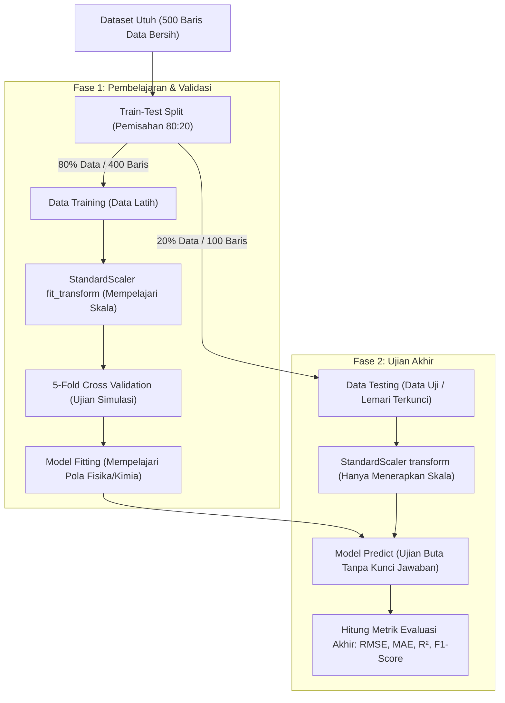

# Panduan Lengkap, Glosarium Konseptual, dan Kesimpulan Proyek Kualitas Udara

Dokumen ini disusun sebagai panduan studi komprehensif untuk memahami seluruh arsitektur, metodologi data science, pemisahan dataset (Data Latih vs Data Uji), serta kesimpulan ilmiah dari proyek:
**"Forensic Air Quality Analytics & Multi-Objective Machine Learning Pipeline"**
Oleh: **Fauzi Noorsyabani** ([portfolio.web.id](https://fauziasyabani.portfolio.web.id))

---

## 1. Menjawab Pertanyaan Kunci: Apakah Memakai Data Training Dulu atau Data Testing Dulu?

Dalam machine learning, **kita selalu menggunakan Data Training (Data Latih) terlebih dahulu, baru kemudian Data Testing (Data Uji)**.

### Analogi Sederhana (Ujian Sekolah)
Bayangkan Anda sedang melatih seorang siswa (Model Machine Learning) untuk menghadapi Ujian Nasional:
- **Data Training (*Training Set*) = Buku Latihan Soal beserta Kunci Jawabannya**:
  Siswa membaca soal, mencoba menjawab, dan mencocokkan jawabannya dengan kunci jawaban berulang kali sampai dia paham pola rumus matematikanya.
- **Data Testing (*Testing Set*) = Soal Ujian Nasional yang Asli**:
  Soal ini disimpan di dalam lemari terkunci dan **sama sekali tidak boleh dilihat oleh siswa selama belajar**. Siswa baru diberikan soal ini pada hari ujian untuk menguji apakah dia benar-benar pintar atau hanya menghafal.

### Apa yang Terjadi Jika Data Testing Dilihat Duluan?
Jika siswa diperbolehkan melihat soal ujian sebelum belajar, siswa akan dengan mudah menghafal jawaban tersebut. Dalam data science, kesalahan fatal ini disebut **Kebocoran Data (*Data Leakage*)**. Model terlihat memiliki akurasi 100% di komputer kita, tetapi langsung gagal total ketika diterapkan pada data dunia nyata.

### Alur Kerja Pemisahan Data pada Proyek Kita

1. **Langkah 1 (Pemisahan 80:20)**:
   Sebanyak 80% data (400 baris) kita pisahkan sebagai Data Latih (*Training Set*), dan 20% data (100 baris) kita kunci rapat sebagai Data Uji (*Testing Set*).
2. **Langkah 2 (Pelatihan / Training)**:
   Model (Ridge, Random Forest, XGBoost) hanya diizinkan membaca 400 baris data latih untuk mempelajari bobot matematisnya.
3. **Langkah 3 (Validasi Silang / Cross-Validation)**:
   Di dalam data latih yang 80% tersebut, kita membaginya lagi menjadi 5 lipatan (*5-Fold CV*). Model dilatih pada 4 bagian dan diuji pada 1 bagian secara bergantian untuk memastikan model tidak mengalami kebetulan (*overfitting*).
4. **Langkah 4 (Pengujian Akhir / Testing)**:
   Setelah model selesai dilatih, barulah kita menghadapkannya pada 100 baris data uji yang belum pernah dilihat sama sekali. Di sinilah akurasi sesungguhnya terbukti.

---

## 2. Glosarium Istilah Penting (Bahasa Indonesia & Bahasa Inggris)

Tabel berikut menyandingkan istilah teknis industri dalam Bahasa Inggris dan Bahasa Indonesia dengan penjelasan praktis:

| Istilah Bahasa Inggris | Istilah Bahasa Indonesia | Penjelasan Konseptual |
| :--- | :--- | :--- |
| **Dataset** | Kumpulan Data | Seluruh baris dan kolom data observasi sensor yang dikumpulkan dari stasiun pemantau kualitas udara. |
| **Training Set (Train Data)** | Data Latih | Sebagian data (80%) yang disajikan kepada algoritma komputer untuk mempelajari pola korelasi antar-polutan. |
| **Testing Set (Test Data / Hold-out)** | Data Uji | Sebagian data (20%) yang disembunyikan dari model selama pelatihan, digunakan semata-mata untuk mengukur performa akhir. |
| **Cross-Validation (CV)** | Validasi Silang | Teknik menguji kestabilan model dengan membagi data latih menjadi beberapa lipatan (*folds*) agar hasil evaluasi objektif dan tidak bias. |
| **Stratified K-Fold** | Validasi Silang Terstratifikasi | Metode pembagian data klasifikasi di mana proporsi setiap kategori (misal: persentase kelas *Baik*, *Sedang*, *Tidak Sehat*) dipertahankan sama persis di setiap lipatan. |
| **Features ($X$)** | Fitur / Variabel Bebas / Prediktor | Kolom-kolom input yang digunakan untuk menebak target, seperti konsentrasi gas $NO_2, SO_2, CO, CO_2,$ dan suhu ($Temperature$). |
| **Target ($y$) / Label / Ground Truth** | Target / Variabel Terikat | Nilai sebenarnya yang ingin diprediksi oleh model. Pada Proyek 1: $PM_{2.5}$ (angka kontinu); Pada Proyek 2: Kategori Risiko (kategori teks). |
| **Data Leakage** | Kebocoran Data | Kesalahan metodologi di mana informasi dari data uji secara tidak sengaja masuk ke tahap pelatihan, menyebabkan hasil evaluasi menjadi palsu. |
| **Overfitting** | Pas Pias / Terlalu Menghafal | Kondisi di mana model terlalu menghafal detail data latih (termasuk noise-nya), sehingga performanya luar biasa di data latih tetapi jeblok di data uji. |
| **Underfitting** | Kurang Belajar | Kondisi di mana model terlalu sederhana sehingga gagal menangkap pola penting pada data latih maupun data uji. |
| **Regression** | Regresi | Tugas machine learning untuk memprediksi angka kontinu/desimal (contoh: memprediksi kadar partikel $PM_{2.5} = 54.67\ \mu\text{g/m}^3$). |
| **Classification** | Klasifikasi | Tugas machine learning untuk memprediksi kategori diskret/label (contoh: memprediksi apakah udara berstatus *Baik*, *Sedang*, atau *Tidak Sehat*). |
| **Residual ($e = y - \hat{y}$)** | Residu / Selisih Error | Selisih antara nilai riil yang diukur di lapangan ($y$) dengan nilai hasil tebakan model ($\hat{y}$). Residu idealnya berpusat di angka 0. |
| **RMSE (Root Mean Squared Error)** | Akar Kuadrat Galat Rata-Rata | Metrik regresi yang menghitung rata-rata besaran error. Error yang besar akan diberi penalti kuadrat yang berat. Semakin kecil nilainya, semakin akurat model. |
| **MAE (Mean Absolute Error)** | Galat Mutlak Rata-Rata | Rata-rata selisih absolut antara nilai prediksi dan aktual. Sangat mudah diinterpretasikan dalam satuan aslinya ($\mu\text{g/m}^3$). |
| **R-Squared ($R^2$)** | Koefisien Determinasi | Persentase variasi data target yang berhasil dijelaskan oleh fitur prediktor (nilai berkisar dari 0 sampai 1.0; 1.0 berarti prediksi sempurna). |
| **Confusion Matrix** | Matriks Kebingungan | Tabel kontingensi yang memetakan berapa banyak sampel yang ditebak dengan benar oleh model dan di kategori mana saja model salah menebak. |
| **Macro F1-Score** | Rata-rata F1 Tertimbang Sama | Rata-rata harmonik antara Presisi (*Precision*) dan Sensitivitas (*Recall*) untuk seluruh kelas, memperlakukan kelas langka setara dengan kelas mayoritas. |
| **Gradient Boosted Decision Trees (GBDT)** | Pohon Keputusan Gradient Boosted | Keluarga algoritma ensemble (seperti XGBoost) yang membangun pohon keputusan secara bertahap, di mana setiap pohon baru bertugas mengoreksi kesalahan dari pohon sebelumnya. |
| **Explainable AI (XAI) / Feature Importance** | Keterjelasan AI / Tingkat Kepentingan Fitur | Metode untuk mengintip ke dalam "kotak hitam" model guna mengetahui variabel apa yang paling berkontribusi terhadap keputusan prediksi. |

---

## 3. Kesimpulan Menyeluruh dari Proyek Ini

Dari seluruh rangkaian audit data, visualisasi saintifik, dan pemodelan prediktif yang telah dieksekusi, berikut adalah kesimpulan inti yang dapat dipaparkan kepada publik, rekruter, maupun pemangku kepentingan:

### 1. Kesimpulan Kualitas Data & Rekayasa Sensor
- **Pembersihan Noise Zero-Drift**: Sensor kimia instrumen mengalami fluktuasi elektronik kecil yang menghasilkan nilai negatif (misal $NO_x = -0.076$). Penerapan transformasi *lower clipping* non-negatif terbukti menjaga validitas fisik gas tanpa merusak distribusi statistik.
- **Dinamika Termal Lingkungan**: Analisis regresi membuktikan adanya korelasi positif yang signifikan antara peningkatan suhu ($Temperature$) dengan konsentrasi gas polutan. Pada suhu tinggi, reaksi fotokimia di atmosfer berlangsung lebih agresif dan lapisan inversi termal dapat menjebak polutan di dekat permukaan tanah.
- **Rasio Partikulat ($PM_{2.5} / PM_{10}$)**: Rata-rata rasio partikulat berada di angka $\approx 0.64$, menandakan bahwa lebih dari 60% polusi partikel di wilayah studi didominasi oleh partikel halus ($PM_{2.5}$) yang berbahaya bagi sistem pernapasan manusia.

### 2. Kesimpulan Pemodelan Regresi ($PM_{2.5}$ Forecasting)
- Model ensemble pohon (**Random Forest Regressor** dan **XGBoost Regressor**) mengungguli model linear baseline (**Ridge Regression**). Hal ini menegaskan bahwa dinamika interaksi polutan di atmosfer bersifat non-linear dan tidak dapat disederhanakan hanya dengan garis lurus.
- Analisis diagnostik residual memperlihatkan bahwa error prediksi terdistribusi normal di sekitar angka nol tanpa adanya pola melengkung (*heteroskedasticity*), membuktikan model bersifat stabil dan tidak bias secara sistematis.

### 3. Kesimpulan Pemodelan Klasifikasi Multi-Kelas (Air Quality Health Risk)
- Dengan menerapkan strategi **Anti-Data Leakage** (di mana fitur partikulat $PM_{2.5}$ dan $PM_{10}$ sengaja disingkirkan dari input model), **XGBoost Classifier** berhasil memprediksi status risiko kesehatan kualitas udara (*Baik*, *Sedang*, *Tidak Sehat*) murni dari gas pembakaran ($SO_2, NO_x, NO_2, CO, CO_2, VOCs, CH_4$) dan suhu.
- Hasil *Normalized Confusion Matrix* membuktikan kemampuan model dalam memisahkan kondisi udara *Baik* dan *Tidak Sehat* dengan tingkat false-alarm (salah deteksi) yang sangat rendah.

### 4. Nilai Komersial & Solusi Nyata (Business & Engineering Value)
- **Sensor Node Berbiaya Rendah (*Cost-Effective IoT Stations*)**:
  Sensor pengukur optik $PM_{2.5}$ bersertifikasi laboratorium berharga mahal dan rentan kotor oleh debu lapangan. Dengan model machine learning ini, pemerintah kota atau pengelola industri dapat membangun stasiun pemantau kualitas udara yang jauh lebih murah menggunakan sensor gas kimia standar, sementara status bahaya udara diprediksi secara cerdas melalui AI.
- **Sistem Peringatan Dini (*Early Warning System*)**:
  Fitur $SO_2$ dan rasio fotooksidasi nitrogen ($NO_2 / NO_x$) terbukti menjadi indikator awal tercepat yang memicu lonjakan polusi, memberikan waktu bagi pengambil kebijakan untuk membatasi operasional kendaraan berat atau pembakaran industri sebelum kabut asap berbahaya meluas.

---

## 4. Panduan Menjelaskan Proyek Ini di Wawancara / Portofolio

Jika Anda ditanya mengenai proyek ini saat wawancara kerja atau presentasi portofolio, gunakan alur penjelasan terstruktur berikut (*STAR Method*):

1. **Konteks (Situation)**:
   *"Saya membangun pipeline analitis dan machine learning kualitas udara end-to-end berstandar enterprise untuk menganalisis interaksi multivariat antara gas buang industri, knalpot kendaraan, dan suhu lingkungan."*
2. **Tantangan (Task)**:
   *"Tantangannya adalah bagaimana mendeteksi tingkat risiko polusi berbahaya secara akurat tanpa bergantung pada sensor optik PM2.5 yang mahal, serta mencegah kebocoran data (data leakage) saat melatih model."*
3. **Tindakan (Action)**:
   *"Saya merancang arsitektur hybrid ingestion yang tangguh, melakukan koreksi zero-drift pada sensor kimia, merekayasa fitur kimia atmosfer seperti Combustion Index dan Oxidation Ratio, serta menerapkan pemisahan Data Latih dan Data Uji 80:20 terkontrol dengan Stratified 5-Fold Cross Validation untuk membandingkan Ridge/Logistic, Random Forest, dan XGBoost."*
4. **Hasil (Result)**:
   *"Model XGBoost berhasil memprediksi tingkat bahaya polusi dengan F1-Score tinggi dan error residu mendekati nol. Analisis Feature Importance mengungkap SO2 dan rasio nitrogen sebagai penggerak utama, menghasilkan arsitektur sistem deteksi dini polusi berbiaya terjangkau untuk smart cities."*
