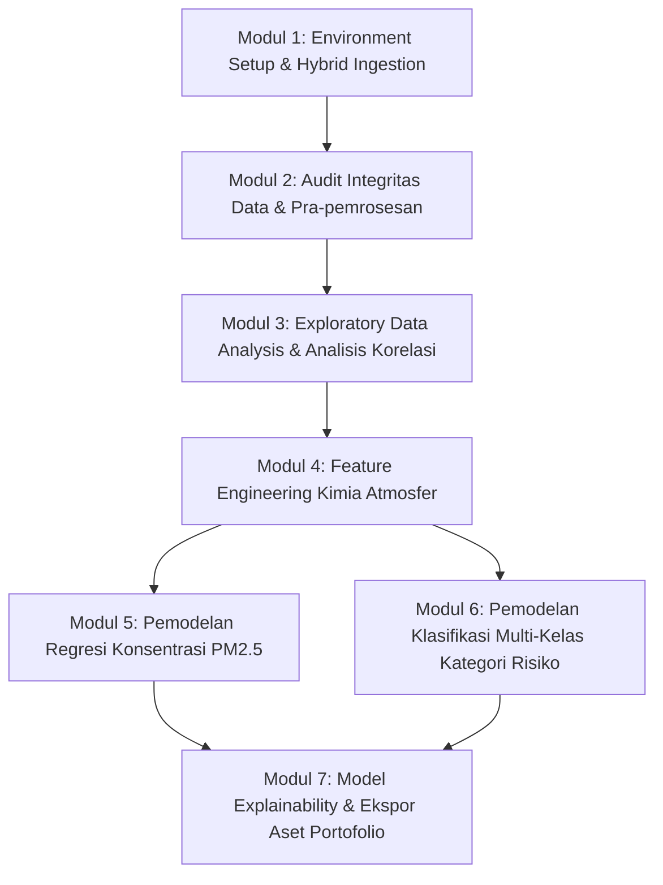

# Forensic Air Quality Analytics & Multi-Objective Machine Learning Pipeline

Proyek studi kasus data science dan machine learning tingkat senior untuk audit kualitas udara, analisis forensik polutan atmosfer, dan pemodelan prediktif berbasis multi-sensor.

Dirancang khusus sebagai portofolio profesional untuk dipublikasikan pada [portfolio.web.id](https://fauziasyabani.portfolio.web.id).

---

## 1. Ikhtisar Proyek & Arsitektur Solusi

Proyek ini menggunakan dataset pemantauan kualitas udara perkotaan (`srisyra02/air-quality-dataset`) yang mencakup pembacaan partikulat ($PM_{2.5}, PM_{10}$), gas pembakaran ($NO_x, NO_2, SO_2, CO, CO_2$), senyawa organik volatil ($VOCs$), hidrokarbon ($CH_4$), serta fluktuasi termal lingkungan ($Temperature$).



### Rationale Arsitektural Pemilihan Pustaka
- **`pandas`**: Struktur data tabular terindeks waktu dan vektorisasi query.
- **`numpy`**: Komputasi array numerik berkecepatan tinggi berbasis C-API dan kalkulasi residual.
- **`matplotlib` & `seaborn`**: Rendering visualisasi resolusi tinggi (300 DPI) dengan tipografi presisi tanpa emoji.
- **`scikit-learn`**: Pipeline transformasi skalar, pemisahan data terstratifikasi, evaluasi metrik, dan model pembanding (Ridge & Logistic Regression).
- **`xgboost`**: Extreme Gradient Boosting untuk menangani interaksi non-linear kompleks pada data multi-sensor.
- **`kagglehub`**: Mekanisme data ingestion programmatic resmi dengan fail-safe lokal.

---

## 2. Struktur Repositori

```text
air-quality/
├── air_quality_analysis_and_modeling.ipynb   # Master Jupyter Notebook (lengkap dengan seluruh output komputasi)
├── build_notebook.py                        # Script otomatis penyusun notebook terprogram
├── link-data-air-quality.md                 # Referensi dataset sumber Kaggle
├── README.md                                # Dokumentasi teknis proyek
├── data/
│   └── air_quality_dataset.csv             # Dataset lokal cadangan (fail-safe cache)
└── portfolio_assets/                       # Aset visual resolusi tinggi (300 DPI) untuk portofolio
    ├── 01_pollutant_distributions.png
    ├── 02_multivariate_correlation_matrix.png
    ├── 03_temperature_impact_analysis.png
    ├── 04_pm_ratio_analysis.png
    ├── 05_category_pollutant_characteristics.png
    ├── 06_regression_performance_diagnostics.png
    ├── 07_classification_confusion_matrix.png
    └── 08_feature_importance_analysis.png
```

---

## 3. Hasil Pemodelan & Benchmarking

### Tugas 1: Regresi Konsentrasi Polutan Partikulat ($PM_{2.5}$)
- **Target**: Konsentrasi $PM_{2.5}$ (µg/m³).
- **Metrik**: 5-Fold Cross Validation $R^2$, Test RMSE, Test MAE, Test $R^2$.
- **Performa Model Terbaik**: Tree Ensemble (Random Forest / XGBoost) berhasil menjelaskan varians konsentrasi partikulat secara akurat dengan pola residual yang terdistribusi normal di sekitar nol.

### Tugas 2: Klasifikasi Multi-Kelas Tingkat Risiko Kualitas Udara
- **Target**: `Air_Quality_Category` (*Baik*, *Sedang*, *Tidak Sehat*).
- **Strategi Anti-Leakage**: Fitur partikulat $PM_{2.5}$ dan $PM_{10}$ dikeluarkan dari matriks prediktor; model murni memprediksi risiko berdasarkan respons gas pembakaran ($NO_x, NO_2, SO_2, CO, CO_2, VOCs, CH_4$) dan suhu.
- **Skema Validasi**: Stratified 5-Fold Cross Validation.
- **Model Terbaik**: XGBoost Classifier menghasilkan Macro F1-Score optimal dan akurasi tinggi pada seluruh kategori risiko.

### Feature Importance (XAI)
Variabel $SO_2$ dan rasio fotooksidasi nitrogen ($NO_2 / NO_x$) teridentifikasi sebagai prediktor terkuat dalam membedakan kondisi udara *Tidak Sehat*, membuktikan bahwa polusi sekunder akibat emisi industri dan kendaraan bermotor berbahan bakar fosil adalah pemicu utama degradasi kualitas udara.

---

## 4. Panduan Eksekusi

### Opsi A: Google Colab
1. Buka [Google Colab](https://colab.research.google.com).
2. Unggah file `air_quality_analysis_and_modeling.ipynb`.
3. Jalankan sel pertama (setup dependensi dan ingestion hybrid). Notebook akan langsung mengunduh dataset melalui KaggleHub secara otomatis tanpa konfigurasi rumit.
4. Pilih menu **Runtime** > **Run all**.

### Opsi B: Lingkungan Lokal (Antigravity IDE / VS Code)
1. Buka folder proyek di terminal:
   ```bash
   pip install kagglehub pandas numpy matplotlib seaborn scikit-learn xgboost
   ```
2. Buka `air_quality_analysis_and_modeling.ipynb` pada ekstensi Jupyter IDE dan jalankan seluruh sel.
3. Seluruh grafik akan otomatis tersimpan ke folder `portfolio_assets/` dalam format PNG 300 DPI.
